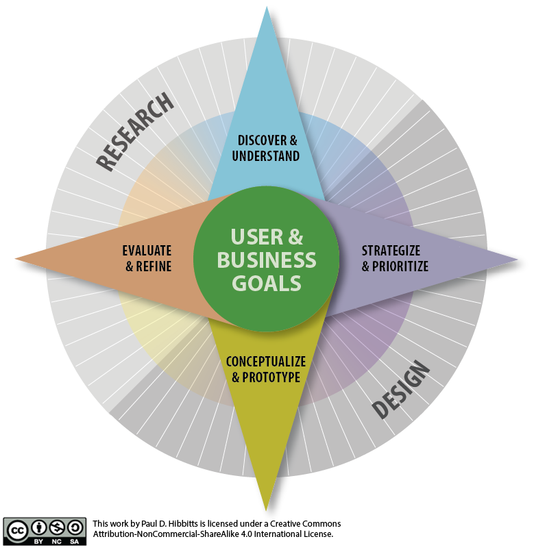

<!-- grav: {"file":"03.modules/03.module-02/course-page.md","images":["4853380320_492f9dce63_b.jpg","ux-design-process-v4.png"]}
title: 'Module 2'
description: 'What does a holistic user experience design process look like?'
header_image: true
header_image_credit: 'CannedTuna, Flickr.com'
header_image_creditlink: 'https://www.flickr.com/photos/cannedtuna/4853380320/'
header_image_alt_text: 'Information architecture'
-->

<!-- grav:gen -->

<small>Photo: [CannedTuna, Flickr.com](https://www.flickr.com/photos/cannedtuna/4853380320/)</small>

# What does a holistic user experience design process look like?
<!-- /grav:gen -->

<!-- grav-embed-line-headings-up: ## **What does a holistic user experience design process look like?** -->

## Summaries and Questions  
[May 16th Class One-minute Summaries](https://canvas.sfu.ca/courses/55288/assignments)

## Presented Slides  
[Placeholder Slides](https://docs.google.com/presentation/d/e/2PACX-1vSPiOUzmRG4EB6ng8KQgOwZEbVuN2u1d5tGVTiAyzlVuO_o4Zjyli3oAf_U_CqXml_6GMUBR9nUyEYb/pub?start=false&loop=false&delayms=3000)

<!-- grav-embed: [googleslides]https://docs.google.com/presentation/d/e/2PACX-1vSPiOUzmRG4EB6ng8KQgOwZEbVuN2u1d5tGVTiAyzlVuO_o4Zjyli3oAf_U_CqXml_6GMUBR9nUyEYb/embed?start=false&loop=false&delayms=3000[/googleslides] -->

<iframe src="https://docs.google.com/presentation/d/e/2PACX-1vSPiOUzmRG4EB6ng8KQgOwZEbVuN2u1d5tGVTiAyzlVuO_o4Zjyli3oAf_U_CqXml_6GMUBR9nUyEYb/embed?start=false&amp;loop=false&amp;delayms=3000" title="Slides" frameborder="0" allowfullscreen="true"></iframe>

## CPT-363 UX Design Process/Toolkit

## Handouts
[Product Reaction Cards](https://canvas.sfu.ca/courses/55288/files)  

## Assignments
[Course Reflection Log](https://canvas.sfu.ca/courses/55288/assignments)  

## Recommended Reading  

<!-- grav-embed: [embedly]https://uxplanet.org/the-evolution-of-ux-process-methodology-47f52557178b[/embedly] -->
<a class="embedly-card" data-card-theme="light" data-card-controls="0" data-card-align="left" href="https://uxplanet.org/the-evolution-of-ux-process-methodology-47f52557178b">https://uxplanet.org/the-evolution-of-ux-process-methodology-47f52557178b</a>
